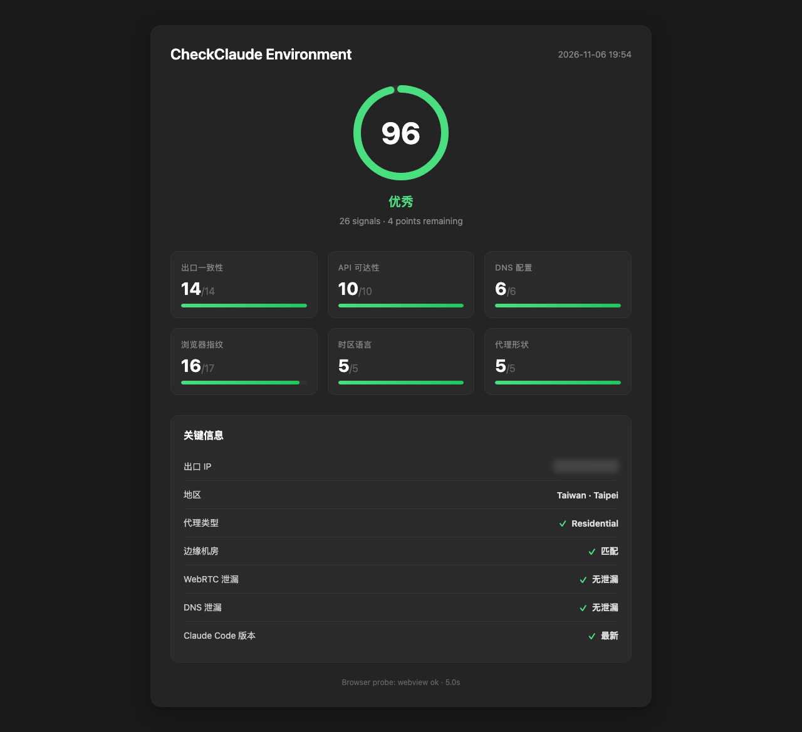
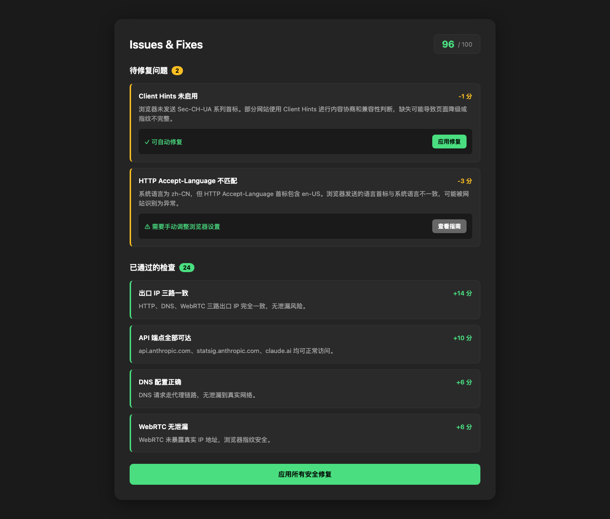
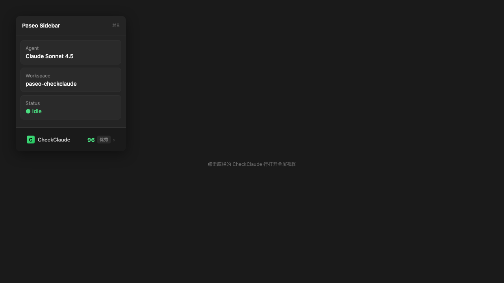
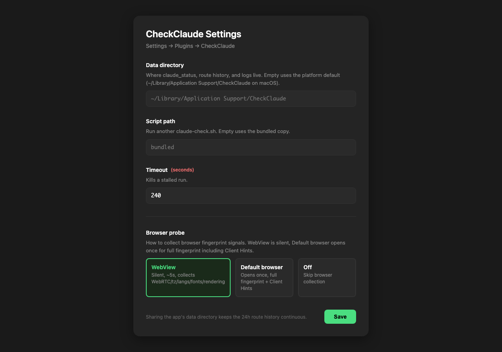

<div align="center">

# CheckClaude for Paseo

**在 Paseo 编辑器里一键检测 Claude Code 运行环境**

[](https://paseo.sh)
[](https://opensource.org/licenses/MIT)
[](https://paseo.sh)
[]()

[English](#features) · [中文](#功能特性)

</div>

---

## 功能特性

CheckClaude 是 [Paseo](https://paseo.sh) 的插件，将 [CheckClaude](https://github.com/zzusec/CheckClaude) 的环境检测能力集成到编辑器中。

### 🎯 26 项加权信号，100 分满分

| 信号组 | 权重 | 检测内容 |
|--------|------|----------|
| **三路出口探测** | 6 分 | 国内、国外和 Cloudflare 等站点回显的公网 IP 是否一致 |
| **API 可达性** | 10 分 | Anthropic API 和 Claude Code 端点是否可达 |
| **DNS 配置** | 6 分 | DNS 是否走代理、是否泄漏 |
| **时区语言** | 5 分 | 系统时区、语言、区域是否一致 |
| **代理形状** | 5 分 | 代理类型、边缘机房匹配度 |
| **浏览器指纹** | 17 分 | WebRTC、时区、语言、Client Hints、字体、WebGL |
| **Claude Code** | 43 分 | 版本、配置、可达性 |

### 🔍 详细的问题诊断

不只是给个分数，还告诉你：
- **每个信号扣了多少分**
- **为什么扣分**（具体原因）
- **怎么修复**（一键应用安全修复）

### 📊 实时状态

- **侧边栏底栏**：显示最近一次检测的分数和等级
- **全屏视图**：详细的信号分解、问题列表、修复建议
- **报告导出**：查看原始 `claude-check.sh` 输出

### 🌐 浏览器信号采集

内置浏览器探针（从 CheckClaude App 移植），无需安装菜单栏应用：

| 模式 | 说明 | 耗时 | 采集内容 |
|------|------|------|----------|
| **WebView** | 静默模式 | ~5s | WebRTC、时区、语言、字体、WebGL、Canvas |
| **默认浏览器** | 打开一次标签页 | ~10s | 完整指纹，含 Client Hints、Sec-Fetch、Accept-Language |
| **关闭** | 跳过采集 | 0s | 仅 shell 检测 |

---

## 截图

<div align="center">

### 主界面：分数与信号分解



### 问题诊断：扣分原因与修复建议



### 侧边栏：实时状态



### 设置：自定义配置



</div>

> 💡 **截图说明**：上方截图为示意图，实际界面以 Paseo 客户端为准。

---

## 安装

### 从 GitHub 安装（推荐）

```bash
paseo plugin install github:Ericwong5021/paseo-checkclaude
```

### 从本地安装

```bash
git clone https://github.com/Ericwong5021/paseo-checkclaude.git
paseo plugin install ./paseo-checkclaude
```

### 要求

- **Paseo** >= 0.15.1
- **系统**：macOS 或 Linux（daemon 端）
- **依赖**：`/bin/bash`、`curl`、`networksetup`（macOS）

---

## 使用

### 命令行

```bash
# 打开检测界面并运行检测
/checkclaude

# 运行检测并自动应用安全修复
/checkclaude fix

# 只查看最近一次的结果（不运行新检测）
/checkclaude view
```

### Command Center（⌘K）

- `Check Claude environment` - 运行检测
- `Fix Claude environment` - 应用安全修复

### 侧边栏

点击底栏的 **CheckClaude** 行打开全屏视图。

### 设置

`Settings → Plugins → CheckClaude`：

| 设置项 | 默认值 | 说明 |
|--------|--------|------|
| **Data directory** | 平台默认路径 | `claude_status`、路由历史、日志的存储位置 |
| **Script path** | 内置脚本 | 使用自定义的 `claude-check.sh` |
| **Timeout** | 240s | 检测超时时间 |
| **Browser probe** | WebView | 浏览器信号采集模式 |

---

## 工作原理

### 架构

```
┌─────────────────────────────────────────────────────────┐
│  Paseo Client (iOS / macOS / Web)                       │
│  ├─ Sidebar footer: 显示实时分数                         │
│  ├─ Full screen: 详细视图（信号、问题、修复）              │
│  └─ Settings: 配置界面                                   │
└────────────────────┬────────────────────────────────────┘
                     │ RPC
                     ▼
┌─────────────────────────────────────────────────────────┐
│  Paseo Daemon (macOS / Linux)                           │
│  ├─ server/run.ts: 任务调度                              │
│  │   ├─ 阶段 1: 浏览器探针 (ccprobe)                     │
│  │   └─ 阶段 2: claude-check.sh                          │
│  ├─ server/parse.ts: 解析 claude_status                  │
│  └─ server/paths.ts: 路径管理                            │
└────────────────────┬────────────────────────────────────┘
                     │
                     ▼
┌─────────────────────────────────────────────────────────┐
│  CheckClaude 数据目录                                    │
│  ~/Library/Application Support/CheckClaude/             │
│  ├─ claude_status: 检测结果（key=value）                 │
│  ├─ browser_signals: 浏览器指纹                          │
│  ├─ network_history: 24h 路由历史                        │
│  └─ auto-timezone.log: 时区日志                          │
└─────────────────────────────────────────────────────────┘
```

### 检测流程

1. **浏览器探针**（可选，~5s）
   - 生成隐藏的 WKWebView 或打开默认浏览器
   - 执行 JavaScript 采集 WebRTC、时区、语言、字体、WebGL 等
   - 写入 `browser_signals` 文件

2. **环境检测**（~20s）
   - 运行 `claude-check.sh`
   - 检测出口 IP、DNS、代理、时区、API 可达性等
   - 读取 `browser_signals` 计算浏览器组分数
   - 写入 `claude_status` 文件

3. **结果解析**
   - 读取 `claude_status` 的 key=value 格式
   - 解析 26 个信号的得分、扣分原因、修复建议
   - 通过 RPC 返回客户端显示

### 数据共享

插件与 CheckClaude App/CLI 共享同一个数据目录，因此：
- 24 小时路由历史连续
- 浏览器指纹可复用
- 无需重复检测

---

## 信号详解

### 三路出口探测（6 分）

通过国内站点、国外站点和 Cloudflare 等站点分别回显公网来源 IP。它与 DNS、WebRTC 的检测分开计分。

- 三路成功且一致：6/6。
- 三路成功但不一致：1/6，并提示分流风险。
- 任一路失败：标记探测失败，展示失败站点及 DNS、TLS、超时等原因。保留本轮成功的结果，失败路显示未知，不使用旧 IP，也不扣这一项的分数。报告仍保留其他已确认风险。
- 恢复后连续两次有效结果确认，避免瞬间变化误报。

### API 可达性（10 分）

检测 Claude Code 需要的 API 端点是否可达：
- `api.anthropic.com`
- `statsig.anthropic.com`
- `claude.ai`

### DNS 配置（6 分）

检测 DNS 是否走代理、是否泄漏：
- DNS 服务器是否在代理链路上
- DNS 请求是否泄漏到真实网络

### 时区语言（5 分）

检测系统时区、语言、区域是否一致：
- 系统时区 vs 浏览器时区
- 系统语言 vs 浏览器语言
- 区域设置是否匹配

### 代理形状（5 分）

检测代理类型和边缘机房匹配度：
- 代理类型（HTTP/SOCKS/VPN）
- 出口 IP 是否在边缘机房
- 与 Claude Code 期望的代理形状是否匹配

### 浏览器指纹（17 分）

检测浏览器指纹的一致性：
- **WebRTC**（6 分）：是否泄漏真实 IP
- **时区**（2 分）：浏览器时区 vs 系统时区
- **语言**（1 分）：浏览器语言 vs 系统语言
- **Client Hints**（1 分）：浏览器是否发送 Client Hints
- **HTTP Accept-Language**（1 分）：HTTP 头语言 vs 系统语言
- **渲染环境**（1 分）：Canvas/WebGL 指纹一致性性
- **字体**（5 分）：浏览器可见字体 vs 系统字体

### Claude Code（43 分）

检测 Claude Code 的配置和状态：
- **版本**（10 分）：是否为最新版本
- **配置**（15 分）：配置文件是否正确
- **可达性**（10 分）：API 端点是否可达
- **运行状态**（8 分）：是否正在运行

---

## 修复建议

插件不仅检测问题，还提供修复建议：

### 安全修复（可一键应用）

- 修复 DNS 泄漏
- 统一时区设置
- 修复语言配置

### 手动修复（需要人工操作）

- 更换代理节点
- 调整防火墙规则
- 更新 Claude Code 版本

---

## 开发

### 本地开发

```bash
# 克隆仓库
git clone https://github.com/Ericwong5021/paseo-checkclaude.git
cd paseo-checkclaude

# 安装依赖
npm install

# 类型检查
npm run typecheck

# 重新生成嵌入脚本
npm run embed

# 本地安装测试
paseo plugin install ./
```

### 项目结构

```
paseo-checkclaude/
├─ index.server.ts          # 服务端入口
├─ index.client.tsx         # 客户端入口
├─ client/
│  ├─ checkclaude-screen.tsx  # 全屏视图
│  ├─ checkclaude-settings.tsx # 设置界面
│  ├─ sidebar.tsx             # 侧边栏底栏
│  ├─ hooks.ts                # React hooks
│  └─ format.ts               # 格式化工具
├─ server/
│  ├─ run.ts                  # 任务调度
│  ├─ parse.ts                # 结果解析
│  ├─ paths.ts                # 路径管理
│  ├─ native/                 # 浏览器探针
│  │  ├─ CheckClaudeProbe.swift
│  │  ├─ main.swift
│  │  └─ build.sh
│  └─ scripts/                # Shell 脚本
│     ├─ claude-check.sh
│     ├─ auto-timezone.sh
│     └─ embedded.ts
├─ shared/
│  └─ checkclaude.ts          # 共享类型定义
├─ paseo-plugin.json           # 插件清单
└─ package.json
```

---

## 致谢

- [CheckClaude](https://github.com/zzusec/CheckClaude) - 原始的环境检测工具（MIT 许可证）
- [Paseo](https://paseo.sh) - 强大的 AI 编辑器平台

---

## 许可证

MIT © [Ericwong5021](https://github.com/Ericwong5021)

---

<div align="center">

**如果这个项目对你有帮助，请给一个 ⭐ Star！**

[GitHub](https://github.com/Ericwong5021/paseo-checkclaude) · [Issues](https://github.com/Ericwong5021/paseo-checkclaude/issues) · [Paseo](https://paseo.sh)

</div>
